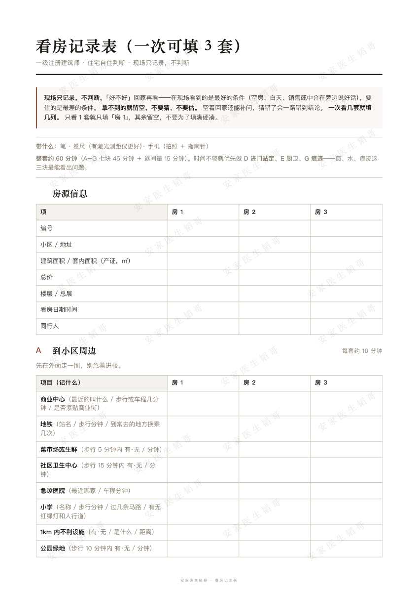

# 看房判断表

> 84 条，一级注册建筑师视角的住宅判断。**新房、二手房都适用**——每条只回答一件事：**住进去之后会不会难受**。

An Agent Skill for judging a home before you buy it — 84 checks, an architect's eye.

<p align="center"></p>

出门前，按房源给你筛出「这套该重点看什么」，生成一张可打印的记录表。  
回家后，按你填回来的数逐条判、算改造账、几套横向比。

**它不判**：房价贵不贵 · 该不该买 · 会不会涨 · 学区 · 落户贷款税费。

**新房和二手房用同一套 84 条。** 房子最终要满足的条件不因为新旧而改变；变的是重点——二手房看时间留下的痕迹，新房看施工本体和样板间的水分。

---

## 为什么不直接把清单贴进 prompt

把 84 条一次性贴给 AI，也能跑。问题是跑出来的东西没用——AI 会把 84 条全列一遍，人在现场看不完，最后只会挑容易的勾几个。

这个 skill 的差别在三个地方。

### ① 现场不用 AI

看房时你要抬头、伸手、拿卷尺，手是占着的；屋子里还有中介、房东、别的看房人。所以现场只有一张纸——填数、拍照，没有对话。

判断全部推到回家做。因为**看房那一刻看到的是这套房最好的条件**（卖家会挑天气、会提前开窗通风、会把霉刷掉），当场下结论一定错。

### ② 只收原始数据，派生值交给 AI 算

记录表不记「最小卧室面积」，只记每个房间的面宽和进深。

面积、最低净高、最小房间——这些回家一起算。人在现场又累又急，算一次错一次，**算错了会一路错到结论**。

同样的理由，过道净宽、门洞宽这类「一般都能满足、真不达标也改不了」的尺寸，整个不采集。少填一格是省 10 秒，多填一格是浪费 5 分钟换一个用不上的判断。

### ③ 四种结论，没有第五种

`达标` / `不达标` / `需人查` / `未采集`。

禁止「基本达标」「问题不大」「总体尚可」。特别是——**`未采集` 不许被顺手写成「没问题」**。这是 AI 最常犯也最危险的错：记录表空着一格，它替你推断成没事，而你带着这个结论去谈价。

---

## 它怎么工作

三段，只有两段用 AI：

| 阶段      | 在哪    | 谁干活                                       | 用时      |
| ------- | ----- | ----------------------------------------- | ------- |
| **出门前** | 在家，电脑 | **AI**：问几个问题（最多 3 次），筛出这套该看的 8–12 条，生成记录表 | 5 分钟    |
| **现场**  | 在房子里  | **你**：填表、拍照。不看手机                          | 约 60 分钟 |
| **回家后** | 在家，电脑 | **AI**：逐条判、算改造账、多套横比                      | 约 40 分钟 |

现场那张表分成 7 块，按**走位**排，不按条目编号排——人是从小区门口走到窗前的：

`A 小区周边` → `B 楼栋外` → `C 进楼` → `D 进门站定` → `E 厨卫` → `F 站定听` → `G 痕迹·门窗·问`

一次看 3 套，同一张表并排填 3 列。A4 共 8 页，打印带走（`记录表_A4打印稿.pdf`）。**最后一页是「判据速查」**——尺寸、面积、一票否决项都在上面，现场对完数就能判一部分。

<p align="center"></p>

---

## 装

仓库根目录就是这个 skill 包，直接 clone 到 skills 目录即可。

**Claude Code**

```bash
git clone https://github.com/OneWay-Dao/anjia-kanfang-judgement.git ~/.claude/skills/kanfang-judgement
```

**WorkBuddy**

```bash
git clone https://github.com/OneWay-Dao/anjia-kanfang-judgement.git ~/.workbuddy/skills/kanfang-judgement
```

只想给某一个项目用，把上面的目标路径换成项目内的 `.claude/skills/` 或 `.workbuddy/skills/`。

装完确认目录长这样：

```
~/.claude/skills/kanfang-judgement/
├── SKILL.md
├── references/
└── assets/
```

---

## 用

**出门前**

> 明天去看一套 1998 年的多层，6 楼顶楼，两室朝南，我和爱人住，没有小孩。该重点看什么？

> 明天去看一套新房，精装交付，28 层，销售说层高 2.9m。该重点看什么？

它会先问新房还是二手房、房龄或交房时间、楼层、结构、住的人（一次最多问 3 个），然后给一份筛过的清单 + 一张记录表。

**两种房问法不同**：二手房会指向时间留下的痕迹（管根、外墙水痕、晾晒痕迹）；新房会指向施工本体和样板间的水分——带卷尺量净高，别信销售说的"层高"。

**现场**

不用打开 AI。表在纸上或手机里，填数、拍照。

**回家后**

> 我看完了，记录表在下面。[粘贴填好的表]

它会逐条给四种结论之一，算出套内单价、得房率，然后把问题分进三栏：

- **甲 · 改不了**——朝向、楼间距、结构形式、承重墙位置
- **乙 · 能改善但追不平**——暗卫加排风还是有潮气；西晒做外遮阳，傍晚那两小时还在
- **丙 · 能追平，但要问追平了哪个属性**——换中空玻璃，隔声保温好了，**采光一点没变**（窗洞尺寸不变）

分栏的意义是：**甲栏决定要不要放弃，丙栏决定要砍多少价**。

**几套一起看**

> 这三套我都填了，帮我排个序。

---

## 文件结构

```
.
├── README.md
├── LICENSE.md
├── 记录表_A4打印稿.pdf    A4 八页，现场打印用（末页判据速查）
├── SKILL.md              入口：路由 + 三条铁律 + 边界（90 行）
├── references/
│   ├── before.md         出门前：问什么、怎么筛、出什么表
│   ├── after.md          回家后：字段→判断的映射表、判定、算账、横比
│   └── rules.md          84 条判据速查 + 依据分级
└── assets/
    ├── 记录表.md         现场用：7 块走位，3 套并列 + 判据速查页
    ├── 记录表_排版.html   A4 排版源文件（改完重新导 PDF 用）
    ├── preview.png       封面预览图
    └── preview-form.png  记录表预览图
```

`SKILL.md` 只做路由和边界，正文 90 行；其余三份按阶段加载，不常驻上下文。

---

## 84 条长什么样

| 段                          | 条数 | 分节                                                                      |
| -------------------------- | -- | ----------------------------------------------------------------------- |
| **一 · 看房前**（在家，20 分钟）      | 22 | 位置与配套 13 · 资料到手 9                                                       |
| **二 · 看房中**（在房子里，25–35 分钟） | 50 | 楼栋外 12 · 公区 5 · 进门 3 · 尺寸 10 · 采光 3 · 厨卫 5 · 日照 3 · 听 3 · 结构痕迹 4 · 门窗 2 |
| **三 · 看房后**（回家，40 分钟）      | 12 | 对户型图 6 · 需要算的 3 · 必须找人查 3                                               |

另有 3.3 改造账和 3.5 横向比两节，是方法不是条目。

每条给三列：**怎么查**（做什么动作）、**规范底线**（什么算不行）、**建议值**（什么算好）。原文照抄一条：

| #     | 项目         | 怎么查                     | 规范底线                                           | 建议值                                |
| ----- | ---------- | ----------------------- | ---------------------------------------------- | ---------------------------------- |
| 2.4.1 | 卧室、起居室室内净高 | 房间中央 + 四角各测一次，取**最低**那个 | 应 ≥2.60m；局部净高 ≥2.20m，且低于 2.60m 的面积不应大于使用面积 1/3 | ≥2.60m 正常；2.40–2.60m 将就；<2.40m 不建议 |

原表还有一列空白的「记录」，是给你现场手写用的。

---

## 完整判断表

仓库里是给模型读的判据——`references/rules.md`，每条一行，只留判据。

**给人看的完整版是另一份东西**：29 页 A4 打印稿，带封面、目录、每条的「怎么查 / 什么算不行 / 为什么重要」，以及一行空白记录栏。可以直接打印带进房子。

在 [Releases](../../releases) 下载 PDF。

---

## 一条判断的依据分五类

不是所有事都有规范可依。写清楚这一点，比假装都有依据更可信。

| 类型        | 条数 | 怎么用                                          |
| --------- | -- | -------------------------------------------- |
| **【强条】**  | 10 | 有确认的条文号，可以直接说「应 ≥X，条文是 YY」                   |
| **【建议】**  | 3  | 有建议值，无强制条文                                   |
| **【经验】**  | 40 | 靠阈值和经验，**不报条文号**                             |
| **【记录】**  | 23 | 只采集，不判断（含 1.2 资料 8 条、3.1 对图纸 6 条、3.2 计算 3 条） |
| **【判不了】** | 8  | 要专业设备或计算，现场做不到（含 3.4 必须找人查的 3 条）             |

**【判不了】这一类是这个项目最想强调的。** 日照要按大寒/冬至用软件算，隔声要拿仪器测分贝，水压要压力表——这些不是「你没看仔细」，是**本来就不可知**。

其中 5 条现场还能记现象，只写「看到了什么」不写「合不合格」：

> ❌ 这套隔声不合格  
> ✅ 关窗还能听清楼上脚步

剩下 3 条（3.4）连现象都判不了，只能直接找人：裂缝性质找结构工程师或鉴定机构、电梯安全看年检报告、产权抵押去不动产登记中心查档。

---

## 关于规范

表里的尺寸对照 **GB 55038-2025《住宅项目规范》**（2025-05-01 实施）。

**这本规范只对新建住宅有强制力。** 看二手房时它只是参考值，不作合规判定——一套 2010 年按 GB 50096-2011 建造的房子，净高 2.45m 完全合规，不该因为达不到新规的 2.60m 就判它「不合格」。

新房必须达到；老房达不到是常态，只说明它是按老标准建的，不说明它有问题。

---

## 边界

**这不是验房报告。** 它记录的是「你走了一圈能看到、能摸到、能量到的东西」，不构成结构安全、消防安全、电气安全的鉴定结论。

裂缝性质、电梯安全、产权抵押查封——表里 3.4 一节专门列了这三件事，并写明每一件找谁。

**它也不替你决定买不买。** 它只把「哪些事花钱能解决、哪些事得天天忍」分开摆出来，决定权在你。

---

## 反馈

判断阈值有异议、规范条文引错、某条在现场根本做不到——都欢迎开 Issue。**引错条文是这个项目最不能接受的错误**，比漏一条严重得多。

---

## 许可

内容（84 条判断标准与全部文字）采用 [CC BY-NC-SA 4.0](LICENSE.md) —— 署名 · 非商业性使用 · 相同方式共享。

商业授权请联系作者。

---

作者：**安家医生韬哥** · 一级注册建筑师 · 十余年建筑设计
